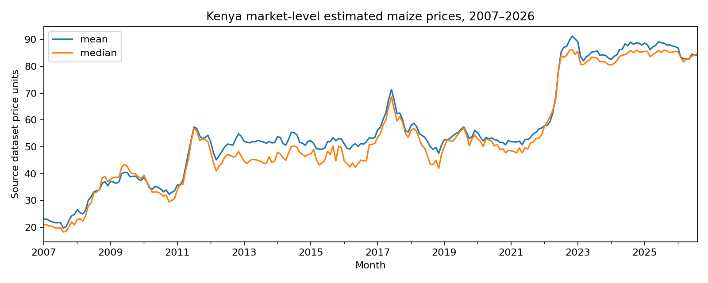
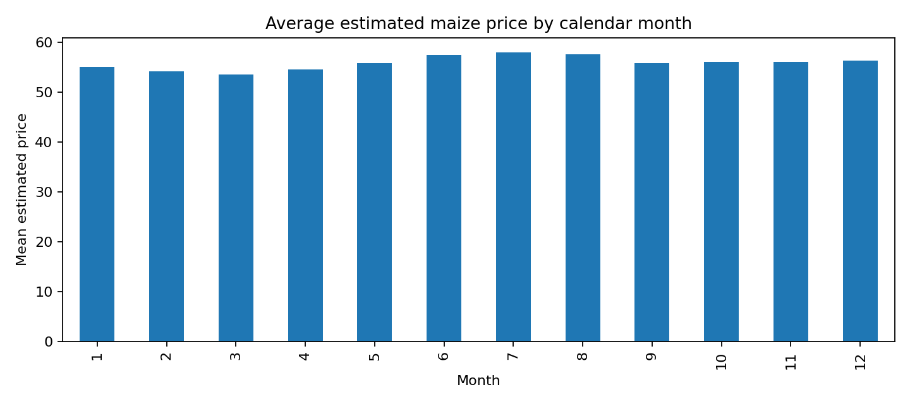
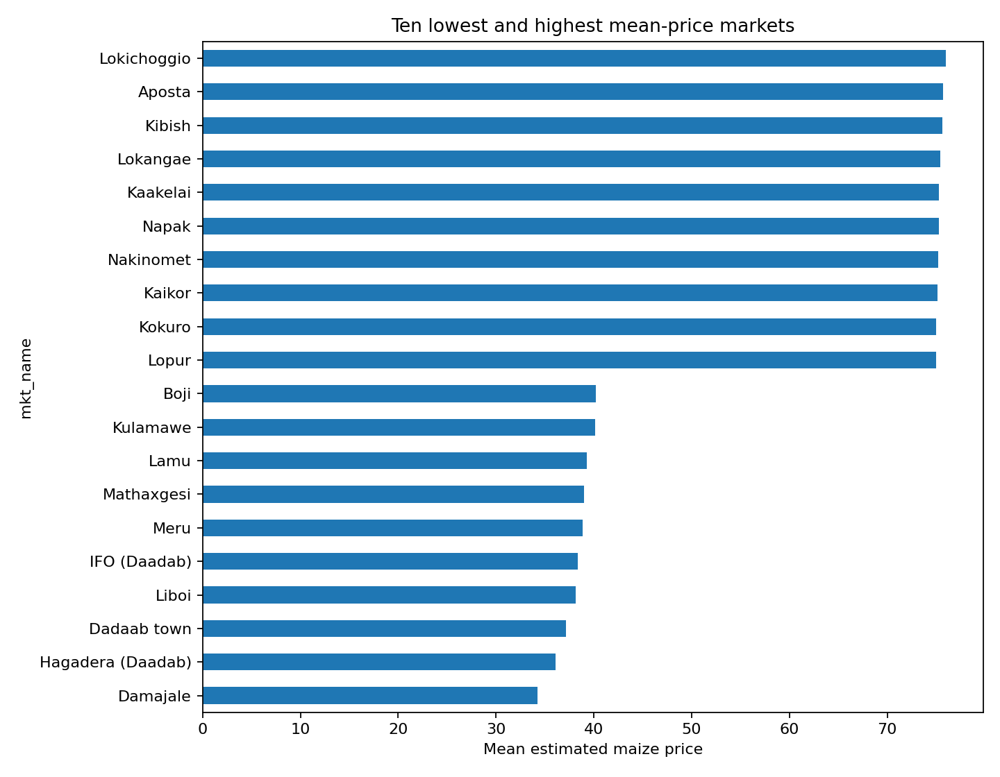

# Forecasting Maize Prices Across Kenyan Markets Using Machine Learning

**DSA 8401 Applied Machine Learning — Individual Capstone**  
**RUHANAMIRINDI BULINDI David | Student number: 224688 | Strathmore University**

## Executive summary

The objective was to build a reproducible system for forecasting next-month maize prices at Kenyan markets and to assess whether conventional machine learning adds value beyond simply carrying the current price forward. The experiment used 55,224 monthly market observations from a World Bank food-price dataset spanning January 2007 to August 2026. A critical distinction is that the modelling target, `c_maize_fao`, is a **model-estimated** maize-price series, not 55,224 directly recorded transactions. Only 2,997 rows contain non-missing values in the direct-observation field `maize_fao`.

The strongest validation method was the simplest: persistence, which assumes next month's estimated price will equal this month's. Its validation MAE was **1.5558**, compared with **1.7362** for Ridge regression, **2.7840** for Random Forest and **3.2021** for histogram gradient boosting. Following the predefined selection rule (lowest validation MAE), persistence was chosen for deployment. On the untouched 2025–2026 test period, it achieved MAE **1.5347** and RMSE **2.3291**. This is a meaningful negative result: added model complexity did not improve the selected validation criterion.

## 1. Problem and relevance

Maize is an important staple in Kenya. Forecasts could, in principle, help traders, households and decision-makers anticipate price movements. The question addressed here is narrower and testable: **Can a model predict next month's published estimated maize price from historical market-level prices more accurately than a persistence baseline?** The unit of analysis is one market-month, and the prediction horizon is one month ahead.

## 2. Data understanding and quality

The supplied World Bank Kenya CSV has 55,224 rows, 46 columns and 234 distinct market names. It covers 2007-01-01 through 2026-08-01, with no duplicated market/date pairs. The series is a balanced panel in this extract. The `maize_fao` direct-observation column is largely missing (2,997 non-missing entries), whereas `c_maize_fao` has complete coverage. The latter was used to enable a consistent market-month forecasting experiment. This choice trades completeness for reliance on estimates.

The code includes a data audit that records missingness and checks duplicated market-month keys. Market histories are sorted before lagging, and the target is generated using a one-month shift within each market. Rows without sufficient historical observations are dropped. Observations are required to have a consecutive next month to preserve the forecasting horizon.

## 3. Exploratory analysis

The scripts generate: (a) an overall time-series plot of the mean and median estimated maize prices, (b) an average-price comparison by calendar month, and (c) a comparison of markets with the lowest and highest long-run mean estimated prices. These charts are descriptive. In particular, calendar-month averages pool multiple years, so they do not isolate seasonal effects from long-term trends. Cross-market price differences may reflect regional conditions and also estimation methodology.

## 4. Feature engineering and leakage control

The predictors are the current estimated price; lagged estimated prices at 1, 2, 3, 6 and 12 months; rolling means over 3, 6 and 12 months; forecast month and year; and market identity. Rolling statistics are calculated through the **current** month, while the label is the **following** month. The target value is never used as an input feature. The first usable forecast target is February 2008, after twelve historical lag months.

Training includes forecast target dates through December 2022 (41,886 examples). Validation is January 2023–December 2024 (5,616 examples), and the untouched test period is January 2025–August 2026 (4,680 examples). Splitting by forecast target date, rather than randomly mixing market-months, reduces direct temporal leakage. However, historical model-estimated values may have been retrospectively constructed using later information, an upstream issue not eliminated by chronological splitting.

## 5. Modelling choices

Four techniques were evaluated. **Persistence** is essential because monthly commodity prices often show strong short-run continuity; a complex model should be judged against it. **Ridge regression** is a regularized linear benchmark that is comparatively interpretable. **Random Forest** can capture nonlinearities and interactions without assuming a linear response. **Histogram Gradient Boosting** provides another nonlinear ensemble with sequential error correction. Numerical missing values are imputed with training-fitted medians; market identity is one-hot encoded with unknown-market handling. All transformations are fit inside training pipelines.

Neural networks, LSTMs and transformers were not used: the panel contains monthly observations and the central question is whether simpler tabular models improve on a strong baseline. Deep sequence models would add complexity and tuning burden without a demonstrated need. Unsupervised clustering is not an alternative to a supervised one-month numeric forecast. The initial study prioritizes a defensible comparison over an exhaustive algorithm catalogue.

## 6. Results and interpretation

| Model | Validation MAE | Validation RMSE |
|---|---:|---:|
| Persistence | **1.5558** | **2.5873** |
| Ridge | 1.7362 | 2.5896 |
| Random Forest | 2.7840 | 3.9042 |
| Histogram Gradient Boosting | 3.2021 | 4.0426 |

Model selection used validation MAE only. Persistence won and was consequently evaluated on the held-out test set: **MAE 1.5347, RMSE 2.3291**. No other test-period model comparison was used to select the champion. MAE expresses the average absolute error in the dataset's price units; RMSE penalizes occasional larger misses more heavily. Because the winning method has no learned coefficients or tree splits, a SHAP explanation of the deployed model would be artificial. Its entire decision rule is transparent: **forecast = current estimated price**.

The result does not mean that machine learning is generally ineffective for Kenyan agricultural markets. It shows that, with these features, this estimated series and this validation period, the tested nonlinear models did not beat persistence on the selected criterion. Additional predictors such as rainfall, transport costs, supply disruptions or exchange rates may be worth studying in a later iteration, provided they are available at forecast time.

## 7. Reproducible pipeline and deployment

`src/data_audit.py` checks the source, `src/eda.py` creates figures, and `src/pipeline.py` performs feature engineering, chronological splitting, model training, validation selection, serialized-artifact creation and test evaluation. Results are saved as JSON and CSV. The selected baseline is represented by versioned JSON metadata and a locally generated joblib artifact. The FastAPI service validates requests and exposes `/health` and `/predict`. A Dockerfile and Compose configuration are supplied to serve the API on port 8000. API calls must supply current and historical features; the service does not itself fetch live prices or update market data.

## 8. Limitations and recommendations

The most important limitation is **target provenance**. Nearly all complete maize values are estimates, and the methodology that produced them may use spatial smoothing or retrospective information. The experiment cannot establish that these forecasts would have worked at the historical time each prediction is dated. The raw observed-price field is too sparse for an equivalent broad-market test without redesigning the sample. The experiment also relies on one temporal holdout and a small set of fixed model hyperparameters, not nested rolling-origin backtesting. The service has no authentication, monitoring or live feed and should not be treated as production-ready.

A useful next stage would compare forecasts on genuinely timestamped, directly observed market prices, add contemporaneously available external covariates and evaluate across multiple rolling origins. The present system is best understood as a **transparent and reproducible educational forecasting demonstration**, not an operational price advisory product.

## Source

World Bank Microdata Library, *Monthly Food Price Estimates by Product and Market*, Kenya extract, dated 2026-08-24. Original source dataset supplied with this capstone.
